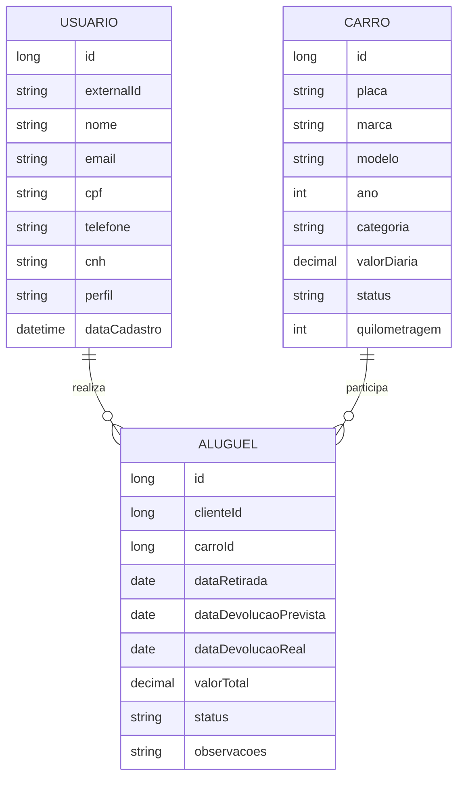
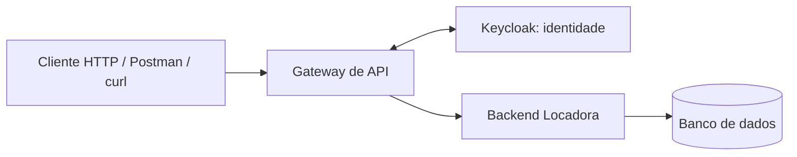
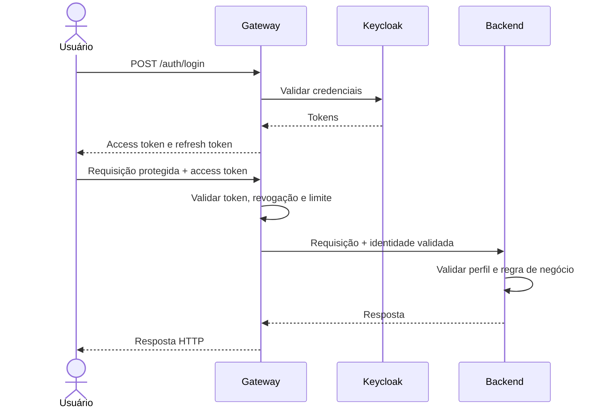

# Locadora API — Sistema de Locação de Veículos

API REST acadêmica do projeto **AV2 — Técnicas de Integração de Sistemas**. O sistema organiza o catálogo de carros, o registro e acompanhamento de aluguéis e os dados de perfil dos usuários. A autenticação é centralizada em um gateway, separado do backend de negócio.

> **Repositório:** https://github.com/mateusmm100-dev/API-Venda-de-Carro  


## Sumário

- [1. Apresentação do sistema](#1-apresentação-do-sistema)
- [2. Recursos e dados gerenciados](#2-recursos-e-dados-gerenciados)
- [3. Perfis e permissões](#3-perfis-e-permissões)
- [4. Arquitetura e tecnologias](#4-arquitetura-e-tecnologias)
- [5. Autenticação e segurança](#5-autenticação-e-segurança)
- [6. Como executar localmente](#6-como-executar-localmente)
- [7. Endpoints documentados](#7-endpoints-documentados)
- [8. Exemplos de requisição](#8-exemplos-de-requisição)
- [9. Erros e respostas HTTP](#9-erros-e-respostas-http)
- [10. Integração com API externa](#10-integração-com-api-externa)
- [11. Estrutura do projeto](#11-estrutura-do-projeto)
- [12. Testes e critérios da atividade](#12-testes-e-critérios-da-atividade)
- [13. Deploy](#13-deploy)
- [14. Limitações e itens a confirmar](#14-limitações-e-itens-a-confirmar)

---

## 1. Apresentação do sistema

A **Locadora API** oferece operações básicas de uma locadora de veículos por meio de endpoints HTTP. Os principais casos de uso são:

- consultar carros disponíveis;
- cadastrar, atualizar, remover e alterar o status de carros conforme o perfil;
- criar e consultar aluguéis;
- registrar retirada, cancelamento e devolução de um aluguel;
- consultar e atualizar o próprio perfil;
- permitir que administradores consultem a lista de usuários com CPF e CNH mascarados.

O backend separa as regras de negócio da autenticação. O gateway autentica o usuário e encaminha a identidade validada para o backend, que aplica as permissões e as regras da locadora.

## 2. Recursos e dados gerenciados

### 2.1 Carro

| Campo | Descrição |
|---|---|
| `id` | Identificador do carro |
| `placa` | Placa única do veículo |
| `marca` | Fabricante |
| `modelo` | Modelo do veículo |
| `ano` | Ano do modelo |
| `categoria` | Categoria do carro |
| `valorDiaria` | Valor cobrado por diária |
| `status` | Estado operacional do veículo |
| `quilometragem` | Quilometragem registrada |

### 2.2 Aluguel

| Campo | Descrição |
|---|---|
| `id` | Identificador do aluguel |
| `clienteId` | Referência ao usuário cliente |
| `carroId` | Referência ao carro alugado |
| `dataRetirada` | Data prevista/registrada para retirada |
| `dataDevolucaoPrevista` | Data prevista para devolução |
| `dataDevolucaoReal` | Data efetiva de devolução, quando houver |
| `valorTotal` | Valor total calculado para o aluguel |
| `status` | Estado atual do aluguel |
| `observacoes` | Observações opcionais |

### 2.3 Usuário

| Campo | Descrição |
|---|---|
| `id` | Identificador local do perfil |
| `externalId` | Identificador do usuário no provedor de identidade |
| `nome` | Nome do usuário |
| `email` | E-mail do usuário |
| `cpf` | CPF, dado pessoal protegido |
| `telefone` | Telefone de contato |
| `cnh` | CNH, dado pessoal protegido |
| `perfil` | Perfil de autorização |
| `dataCadastro` | Data de criação do perfil local |

CPF e CNH são dados pessoais e não devem ser expostos integralmente em listagens administrativas. O perfil local de negócio é separado das credenciais usadas para login.

## 3. Perfis e permissões

Os perfis documentados são `CLIENTE`, `STAFF` e `ADMIN`.

| Operação | CLIENTE | STAFF | ADMIN |
|---|:---:|:---:|:---:|
| Listar carros | Apenas disponíveis | Sim | Sim |
| Consultar carro por ID | Apenas se permitido pelas regras do serviço | Sim | Sim |
| Criar, editar ou remover carro | Não | Não | Sim |
| Alterar status do carro | Não | Sim | Sim |
| Criar aluguel | Sim, para si mesmo | Não | Não |
| Listar os próprios aluguéis | Sim | Sim | Sim |
| Listar todos os aluguéis | Não | Sim | Sim |
| Consultar aluguel por ID | Apenas o próprio | Sim | Sim |
| Cancelar aluguel | Apenas o próprio, enquanto reservado | Sim | Sim |
| Registrar retirada ou devolução | Não | Sim | Sim |
| Listar usuários | Não | Não | Sim |
| Consultar/atualizar o próprio perfil | Sim | Sim | Sim |

O backend também verifica a propriedade do aluguel para impedir que um cliente consulte ou cancele o aluguel de outra pessoa.

### Diagrama simplificado dos dados



## 4. Arquitetura e tecnologias

A arquitetura tem três partes:

1. **Provedor de identidade:** Keycloak, configurado para o realm de demonstração `locadora`.
2. **Gateway de API:** recebe login/cadastro, valida tokens, aplica limites de requisições e encaminha chamadas para o backend.
3. **Backend da locadora:** implementa entidades, regras de negócio, validação de entrada e permissões por perfil.

Tecnologias identificadas na configuração do projeto:

- Java e Spring Boot;
- Spring Security e Spring Cloud Gateway;
- Spring Data JPA e Hibernate;
- Bean Validation;
- Keycloak;
- H2 para desenvolvimento/testes;
- PostgreSQL para configuração de produção;
- Maven;
- Docker Compose para subir os serviços em conjunto.

### Diagrama de arquitetura



## 5. Autenticação e segurança

### 5.1 Fluxo configurado

1. O cliente envia cadastro para `POST /auth/register` ou credenciais para `POST /auth/login` no gateway.
2. O gateway solicita ao Keycloak o cadastro ou a autenticação.
3. No login bem-sucedido, o gateway retorna tokens ao cliente.
4. Para acessar uma rota protegida, o cliente envia o access token no cabeçalho `Authorization: Bearer <access_token>`.
5. O gateway valida o token, verifica se ele foi revogado, aplica rate limiting e determina o perfil pelas roles do token.
6. O gateway remove os cabeçalhos internos que possam ter sido enviados pelo cliente e injeta a identidade validada e o segredo compartilhado para a chamada ao backend.
7. O backend valida o segredo e aplica autorização por perfil e regras de negócio.
8. `POST /auth/logout` revoga o access token atual na lista local de revogação e tenta encerrar a sessão no Keycloak se um refresh token for enviado.

### Diagrama de sequência



### 5.2 Motivo, pontos fortes e limitações

A separação por gateway centraliza as políticas de entrada e deixa o backend concentrado nas regras da locadora. Isso também reduz a duplicação de lógica de autenticação entre endpoints.

Pontos fortes:

- credenciais ficam sob responsabilidade do provedor de identidade;
- políticas de entrada são aplicadas em um ponto central;
- autorização de negócio continua sendo verificada pelo backend;
- o gateway remove cabeçalhos de identidade enviados pelo cliente antes de inserir os próprios valores.

Limitações:

- o gateway é um ponto crítico de disponibilidade;
- há mais componentes para configurar e monitorar;
- o segredo compartilhado precisa permanecer privado;
- lista de revogação e limitadores em memória não compartilham estado automaticamente entre instâncias.

### 5.3 Atenção: requisito de autenticação da atividade

O PDF da atividade proíbe **Basic Auth, Bearer Token, OAuth 2.0 e API Key**. A implementação descrita acima usa Keycloak e tokens JWT enviados no cabeçalho Bearer; portanto, **a solução atual pode não atender ao requisito de escolher um mecanismo diferente dos proibidos**. O fato de existir um gateway não muda, por si só, o mecanismo de token usado na comunicação com o cliente. Confirmem com o professor se essa abordagem foi aceita antes da entrega. Esta documentação não afirma que o requisito já foi cumprido.

### 5.4 Proteções configuradas

| Controle | Configuração identificada |
|---|---|
| Armazenamento de senhas | Gerenciado pelo Keycloak; o backend de negócio não armazena a senha de login |
| Validade do access token | 300 segundos (5 minutos) na configuração de realm de demonstração |
| Proteção contra força bruta | Keycloak configurado para ativar proteção após falhas repetidas |
| Limite de login/cadastro | Configuração padrão de 5 requisições por minuto |
| Limite da API | Configuração padrão de 60 requisições por minuto por usuário |
| Logout | Lista local de revogação até a expiração e tentativa de encerrar a sessão do Keycloak com refresh token |
| Comunicação gateway/backend | Segredo compartilhado via `GATEWAY_SHARED_SECRET` e cabeçalho interno `X-Gateway-Secret` |
| CORS | Configurável por `CORS_ALLOWED_ORIGINS` |

Os limites e a lista de revogação em memória são adequados para demonstração, mas precisam de armazenamento compartilhado e configuração de proxy confiável se a aplicação for escalada para múltiplas instâncias. Os valores de desenvolvimento não devem ser usados em produção.

### 5.5 Contas de demonstração do realm local

O arquivo de realm de demonstração contém contas de teste com estas roles:

| Usuário | Perfil |
|---|---|
| `maria@email.com` | `CLIENTE` |
| `joao@email.com` | `CLIENTE` |
| `ana@locadora.com` | `STAFF` |
| `carlos@locadora.com` | `ADMIN` |

No realm de desenvolvimento fornecido, a senha inicial configurada para essas contas é `Senha@123`. Essas credenciais são públicas e servem apenas para a demonstração local. Altere-as antes de qualquer exposição pública e nunca use contas de teste em produção.

## 6. Como executar localmente

### 6.1 Pré-requisitos

- Git;
- Docker Engine ou Docker Desktop com Docker Compose.

O modo Docker Compose é o caminho recomendado, pois sobe Keycloak, gateway e backend juntos. Para execução manual dos módulos Java, consulte os `pom.xml` e as configurações de cada módulo; será necessário ter os JDKs e o Maven compatíveis com esses módulos.

### 6.2 Clonar e iniciar

```bash
git clone https://github.com/mateusmm100-dev/API-Venda-de-Carro.git
cd API-Venda-de-Carro
git switch dev
docker compose up --build
```

Depois que os serviços iniciarem:

- Gateway/API: `http://localhost:8000`
- Console do Keycloak: `http://localhost:8180`
- Health check do gateway, se habilitado: `http://localhost:8000/actuator/health`

O backend não publica uma porta no host no Compose de desenvolvimento; as chamadas de API devem passar pelo gateway na porta `8000`.

Para encerrar os serviços, use `Ctrl+C` e execute:

```bash
docker compose down
```

Para remover também os volumes persistentes criados pelo Compose, revise antes os volumes existentes e use a opção apropriada; não remova dados que queira preservar.

### 6.3 Variáveis de ambiente

O repositório contém `.env.example`. Crie um arquivo `.env` na raiz, se for necessário personalizar os valores.

Linux/macOS:

```bash
cp .env.example .env
```

PowerShell:

```powershell
Copy-Item .env.example .env
```

| Variável | Finalidade |
|---|---|
| `GATEWAY_SHARED_SECRET` | Segredo compartilhado entre gateway e backend; deve ser igual nos dois serviços |
| `PORT` | Porta HTTP da aplicação, padrão definido pela configuração do serviço |
| `SPRING_PROFILES_ACTIVE` | Perfil Spring a ativar, por exemplo `prod` |
| `DATABASE_URL` | URL JDBC do PostgreSQL em produção |
| `DATABASE_USER` / `DATABASE_PASSWORD` | Credenciais do banco de produção |
| `KEYCLOAK_URL` | Endereço base do Keycloak |
| `KEYCLOAK_REALM` | Realm de autenticação, padrão `locadora` |
| `KEYCLOAK_CLIENT_ID` | Cliente utilizado no fluxo de autenticação |
| `KEYCLOAK_ADMIN_CLIENT_SECRET` | Segredo do cliente administrativo do gateway |
| `BACKEND_URL` | Endereço interno do backend visto pelo gateway |
| `RATE_LIMIT_AUTH_PER_MINUTE` | Limite por minuto para login/cadastro |
| `RATE_LIMIT_API_PER_MINUTE` | Limite por minuto para chamadas autenticadas |
| `RATE_LIMIT_TRUST_XFF` | Define se o gateway confia em `X-Forwarded-For`; só habilite atrás de proxy confiável |
| `CORS_ALLOWED_ORIGINS` | Origens autorizadas pelo CORS |

Não publique segredos reais no GitHub. Os valores padrão de desenvolvimento são apenas para testes locais.

## 7. Endpoints documentados

As rotas abaixo são as que constam no contrato de backend de referência. As rotas de autenticação são servidas pelo gateway; as demais passam pelo gateway e são encaminhadas ao backend.

### 7.1 Autenticação — gateway

| Método | Rota | Acesso | Função |
|---|---|---|---|
| `POST` | `/auth/register` | Público | Criar conta de cliente |
| `POST` | `/auth/login` | Público | Autenticar usuário e retornar tokens |
| `POST` | `/auth/logout` | Autenticado | Revogar token atual e, se informado, encerrar sessão com refresh token |

### 7.2 Carros — backend

| Método | Rota | Permissão |
|---|---|---|
| `GET` | `/carros` | Usuário autenticado; cliente vê apenas disponíveis |
| `GET` | `/carros/{id}` | Usuário autenticado, conforme regra de visibilidade |
| `POST` | `/carros` | `ADMIN` |
| `PUT` | `/carros/{id}` | `ADMIN` |
| `DELETE` | `/carros/{id}` | `ADMIN` |
| `PATCH` | `/carros/{id}/status` | `STAFF` ou `ADMIN` |

A consulta de detalhes com integração externa não é listada como endpoint disponível nesta documentação, porque o arquivo de referência informa que essa funcionalidade ainda deve ser implementada/integrada. Não use uma rota não confirmada como exemplo de funcionalidade pronta.

### 7.3 Aluguéis — backend

| Método | Rota | Permissão |
|---|---|---|
| `POST` | `/alugueis` | `CLIENTE`; cria aluguel para o próprio usuário |
| `GET` | `/alugueis/meus` | Usuário autenticado; retorna os próprios aluguéis |
| `GET` | `/alugueis` | `STAFF` ou `ADMIN` |
| `GET` | `/alugueis/{id}` | Dono do aluguel, `STAFF` ou `ADMIN` |
| `PATCH` | `/alugueis/{id}/cancelar` | Dono do aluguel enquanto reservado, `STAFF` ou `ADMIN` |
| `PATCH` | `/alugueis/{id}/retirada` | `STAFF` ou `ADMIN` |
| `PATCH` | `/alugueis/{id}/devolucao` | `STAFF` ou `ADMIN` |

### 7.4 Usuários — backend

| Método | Rota | Permissão |
|---|---|---|
| `GET` | `/usuarios` | `ADMIN`; CPF/CNH mascarados |
| `GET` | `/usuarios/me` | Usuário autenticado; próprio perfil |
| `PUT` | `/usuarios/me` | Usuário autenticado; atualiza o próprio perfil |

### 7.5 Como autenticar nas rotas protegidas

Faça login em `/auth/login` e use o valor de `access_token` retornado no cabeçalho `Authorization` de cada chamada protegida:

```http
Authorization: Bearer <access_token>
```

O token precisa estar válido e não revogado. O gateway valida o token antes de encaminhar a requisição. Não envie manualmente `X-User-Id`, `X-User-Role` ou `X-Gateway-Secret`; esses cabeçalhos são internos e devem ser inseridos pelo gateway.

## 8. Exemplos de requisição

Os exemplos abaixo assumem que o projeto está rodando localmente e que o gateway está em `http://localhost:8000`.

### 8.1 Criar conta

```bash
curl -i -X POST http://localhost:8000/auth/register \
  -H 'Content-Type: application/json' \
  -d '{"nome":"Novo Cliente","email":"cliente.novo@example.com","senha":"SenhaForte123"}'
```

A senha precisa ter pelo menos 8 caracteres. Use um e-mail que ainda não esteja cadastrado no realm.

### 8.2 Fazer login

```bash
curl -i -X POST http://localhost:8000/auth/login \
  -H 'Content-Type: application/json' \
  -d '{"username":"maria@email.com","password":"Senha@123"}'
```

A resposta bem-sucedida contém `access_token` e `refresh_token`. Os usuários e senhas definidos no realm importado são credenciais **somente de demonstração**; não as reutilize em ambiente público.

### 8.3 Guardar o token no terminal

Exemplo para Bash, com `jq` instalado:

```bash
TOKEN=$(curl -s -X POST http://localhost:8000/auth/login \
  -H 'Content-Type: application/json' \
  -d '{"username":"maria@email.com","password":"Senha@123"}' \
  | jq -r '.access_token')
```

No PowerShell, faça login e copie o campo `access_token` da resposta JSON para uma variável:

```powershell
$token = 'COLE_AQUI_O_ACCESS_TOKEN'
```

### 8.4 Listar carros

```bash
curl -i http://localhost:8000/carros \
  -H "Authorization: Bearer $TOKEN"
```

Um cliente deve receber apenas carros disponíveis conforme as regras do backend.

### 8.5 Criar carro como ADMIN

```bash
curl -i -X POST http://localhost:8000/carros \
  -H "Authorization: Bearer $TOKEN_ADMIN" \
  -H 'Content-Type: application/json' \
  -d '{"placa":"XYZ1A23","marca":"Fiat","modelo":"Argo","ano":2024,"categoria":"ECONOMICO","valorDiaria":110.00,"quilometragem":500}'
```

`TOKEN_ADMIN` deve ser obtido ao autenticar com uma conta que tenha a role `ADMIN`. O corpo deve respeitar os campos e valores aceitos pela validação do projeto.

### 8.6 Criar aluguel como CLIENTE

```bash
curl -i -X POST http://localhost:8000/alugueis \
  -H "Authorization: Bearer $TOKEN" \
  -H 'Content-Type: application/json' \
  -d '{"carroId":1,"dataRetirada":"2030-01-10","dataDevolucaoPrevista":"2030-01-13"}'
```

A criação é destinada ao perfil `CLIENTE`, usa a identidade autenticada como dono do aluguel e depende de o carro e o período atenderem às regras de negócio. Antes de criar um aluguel, complete o perfil se faltarem os dados exigidos.

### 8.7 Completar o próprio perfil

```bash
curl -i -X PUT http://localhost:8000/usuarios/me \
  -H "Authorization: Bearer $TOKEN" \
  -H 'Content-Type: application/json' \
  -d '{"nome":"Maria Souza","cpf":"529.982.247-25","telefone":"85999998888","cnh":"12345678900"}'
```

Use dados de teste, não dados pessoais reais em exemplos publicados.

### 8.8 Registrar devolução como STAFF ou ADMIN

```bash
curl -i -X PATCH http://localhost:8000/alugueis/1/devolucao \
  -H "Authorization: Bearer $TOKEN_STAFF" \
  -H 'Content-Type: application/json' \
  -d '{"quilometragemFinal":30500}'
```

`TOKEN_STAFF` deve pertencer a uma conta com role `STAFF` ou `ADMIN`. O ID `1` é ilustrativo: use um aluguel existente e em estado compatível.

### 8.9 Logout

```bash
curl -i -X POST http://localhost:8000/auth/logout \
  -H "Authorization: Bearer $TOKEN" \
  -H 'Content-Type: application/json' \
  -d '{"refresh_token":"COLE_AQUI_O_REFRESH_TOKEN"}'
```

O corpo com `refresh_token` é opcional. Sem ele, o gateway ainda tenta invalidar o access token atual na lista de revogação local.

## 9. Erros e respostas HTTP

| Código | Significado | Exemplo de causa |
|---|---|---|
| `400 Bad Request` | Requisição malformada ou parâmetro inválido | JSON inválido ou parâmetro em formato incorreto |
| `401 Unauthorized` | Autenticação ausente, inválida, expirada ou revogada | Chamada protegida sem token |
| `403 Forbidden` | Usuário autenticado sem permissão | Cliente tentando cadastrar carro |
| `404 Not Found` | Recurso não encontrado ou não visível ao perfil | ID inexistente ou carro indisponível para cliente |
| `409 Conflict` | Conflito de regra de negócio | Placa duplicada ou transição de estado inválida |
| `422 Unprocessable Entity` | Dados não passam pela validação | Campos obrigatórios ausentes ou e-mail inválido |
| `429 Too Many Requests` | Limite de requisições excedido | Muitas chamadas dentro da janela configurada |
| `500 Internal Server Error` | Erro inesperado no servidor | Falha não tratada |

### Exemplo de 401 — token ausente

```bash
curl -i http://localhost:8000/carros
```

O gateway deve responder `401 Unauthorized` porque a rota exige autenticação.

### Exemplo de 403 — perfil sem permissão

Autentique-se como `CLIENTE` e tente criar um carro:

```bash
curl -i -X POST http://localhost:8000/carros \
  -H "Authorization: Bearer $TOKEN_CLIENTE" \
  -H 'Content-Type: application/json' \
  -d '{"placa":"XYZ1A23","marca":"Fiat","modelo":"Argo","ano":2024,"categoria":"ECONOMICO","valorDiaria":110.00,"quilometragem":500}'
```

A operação deve ser recusada com `403 Forbidden` porque o cadastro de carros é restrito a `ADMIN`.

### Exemplo de 422 — cadastro inválido

```bash
curl -i -X POST http://localhost:8000/auth/register \
  -H 'Content-Type: application/json' \
  -d '{"nome":"Cliente","email":"email-invalido","senha":"123"}'
```

O gateway rejeita o e-mail inválido e a senha com menos de 8 caracteres. A estrutura exata da mensagem depende do handler que responder à requisição.

## 10. Integração com API externa

**Status nesta documentação: pendente de confirmação/implementação no backend de referência.** O arquivo de referência informa que a integração e a rota de detalhes com dados externos são responsabilidade de outro integrante e ainda devem ser adicionadas. Por isso, este README não declara uma API externa funcional, não promete dados retornados e não fornece um exemplo de chamada que não esteja confirmado.

O PDF da atividade exige que a aplicação faça pelo menos duas requisições à API externa e combine esses dados com os dados locais. Para concluir este requisito, a equipe precisa registrar no README, após a implementação real:

1. o nome e a URL-base da API externa;
2. quais duas ou mais requisições são executadas;
3. quais campos são retornados pela API externa;
4. como esses campos são combinados com os dados locais;
5. o comportamento quando a API externa falha ou não encontra correspondência;
6. um exemplo real de requisição e resposta da funcionalidade implementada.

Não marque esse requisito como concluído até testar a integração de ponta a ponta.

## 11. Estrutura do projeto

```text
.
├── gateway/                 # Gateway de API e endpoints de autenticação
│   └── src/main/java/       # Login, cadastro, logout, filtros e rate limiting
├── keycloak/                # Realm de demonstração importado pelo Keycloak
├── src/main/java/           # Backend da locadora
│   └── br/unifor/locadora/
│       ├── config/          # Configuração e dados de demonstração
│       ├── controller/      # Controllers de carros, aluguéis e usuários
│       ├── domain/          # Entidades e enums
│       ├── dto/              # Objetos de requisição e resposta
│       ├── exception/       # Tratamento de erros
│       ├── repository/      # Persistência com Spring Data JPA
│       ├── security/        # Validação da identidade recebida do gateway
│       ├── service/         # Regras de negócio
│       └── util/            # Validação de CPF e mascaramento
├── src/test/                # Testes automatizados do backend
├── .env.example             # Modelo de variáveis de ambiente
├── docker-compose.yml       # Inicialização local dos serviços
├── Dockerfile               # Imagem do backend
└── pom.xml                  # Dependências Maven do backend
```

## 12. Testes e critérios da atividade

Execute os testes do backend com Maven, na raiz do módulo principal:

```bash
mvn test
```

Os testes do gateway estão no módulo `gateway`; para executá-los separadamente:

```bash
cd gateway
mvn test
```

Os testes devem ser usados para verificar, no mínimo, autenticação, permissões, validação de entrada e regras de negócio. Para a entrega, também é necessário testar as chamadas do gateway e o comportamento de rate limiting. Não declare cobertura de testes ou integração externa sem conferir os resultados atuais da suíte.

## 13. Deploy

Não há um endereço de produção confirmado neste README. O PDF exige que o sistema esteja publicado e acessível durante a apresentação; portanto, a equipe deve realizar o deploy, testá-lo e substituir esta seção pela URL real.

O `docker-compose.yml` serve para execução local. Um deploy completo precisa configurar separadamente os serviços de identidade, gateway e backend, além das variáveis de ambiente, conectividade privada entre gateway e backend e banco de dados de produção. Não exponha o backend diretamente à internet se ele confiar nos cabeçalhos injetados pelo gateway.

Depois do deploy, preencher:

- **URL do gateway/API:** `PREENCHER_COM_URL_REAL`
- **URL de health check, se publicada:** `PREENCHER_COM_URL_REAL`
- **Como testar:** executar os exemplos das seções 8 e 9 usando a URL publicada e tokens obtidos no próprio ambiente.

Não deixe os textos `PREENCHER_COM_URL_REAL` na versão final entregue.

## 14. Limitações e itens a confirmar

- A integração com API externa está marcada como pendente neste documento até que seja confirmada no backend entregue.
- A URL de deploy não foi fornecida/confirmada; não inventar um endereço.
- Os dados de demonstração e segredos padrão não são apropriados para produção.
- A lista de revogação e os limitadores em memória não são compartilhados entre instâncias do gateway.
- A configuração de banco em produção usa `ddl-auto: update`; para uso real, avaliar migrações versionadas.

---

**Documento preparado para a branch `dev`.** Atualize esta documentação quando a integração externa, o deploy ou qualquer rota mudar, sempre conferindo o código implementado antes de adicionar novos endpoints.
