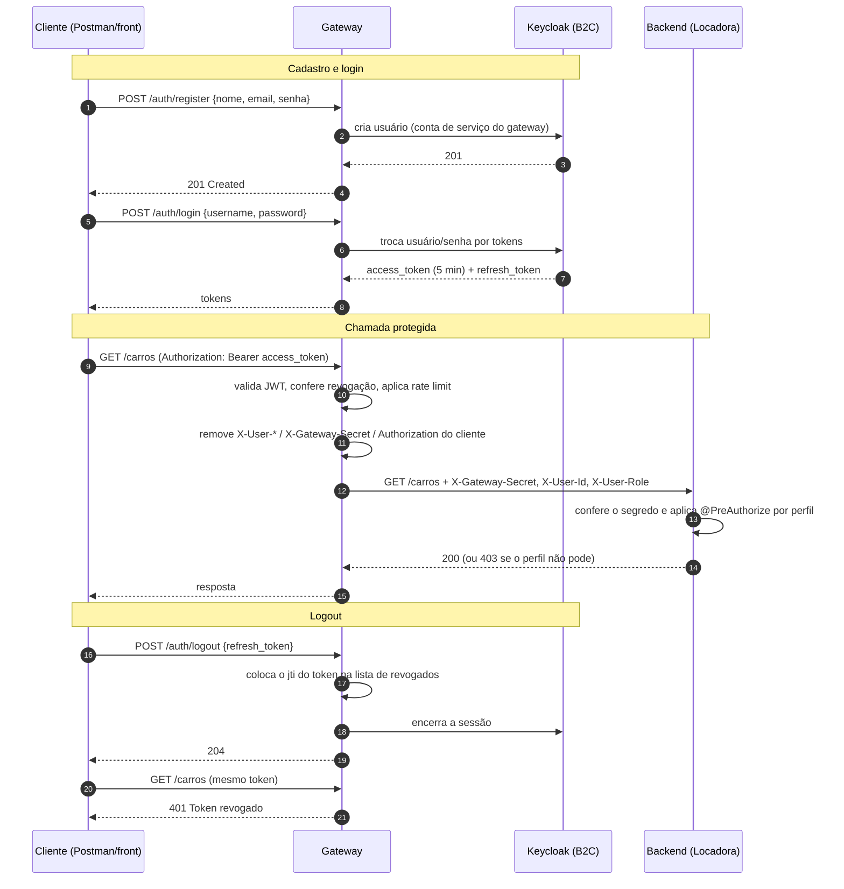

# Autenticação via Gateway de API B2C

> Texto pronto para entrar no README (seções de autenticação) e para estudar antes da apresentação.

## 1. O que é e como funciona

O cliente final (B2C) **nunca fala direto com o backend**. Toda requisição passa por um **gateway de API**, que:

1. recebe o token do cliente e **valida** a identidade (assinatura, emissor, validade);
2. aplica **políticas** (rate limiting, bloqueio de anônimos, CORS, revogação de token);
3. descobre o **perfil** (CLIENTE, STAFF ou ADMIN);
4. **apaga** qualquer header de identidade que o cliente tenha mandado e **injeta** os seus próprios;
5. só então encaminha para o backend.

O **provedor de identidade** (Keycloak) cuida do ciclo de vida da conta do consumidor: cadastro, login, senhas, bloqueio por tentativas, sessões.

### Componentes

| Peça | Função | Tecnologia |
|---|---|---|
| Provedor B2C | Cadastro, login, guarda senhas, emite tokens, define roles | Keycloak 24 |
| Gateway | Porta única de entrada: valida, aplica políticas, injeta identidade | Spring Cloud Gateway (Java 17) |
| Backend | Regras de negócio e permissões por perfil | Spring Boot (Integrante 2) |

### Fluxo passo a passo



## 2. Endpoints de autenticação

| Método e rota | Acesso | O que faz |
|---|---|---|
| `POST /auth/register` | Público | Cria a conta do cliente (perfil CLIENTE por padrão). 409 se o e-mail já existe, 422 se dados inválidos |
| `POST /auth/login` | Público | Devolve `access_token`, `refresh_token`, `expires_in`. 401 se credenciais inválidas |
| `POST /auth/logout` | Autenticado | Revoga o access token atual e encerra a sessão (envie `refresh_token` no corpo) |

Demais rotas (`/carros`, `/alugueis`, `/usuarios`) exigem `Authorization: Bearer <access_token>`.

## 3. Como o perfil chega ao backend

- No Keycloak, cada usuário tem uma **role de realm**: `CLIENTE`, `STAFF` ou `ADMIN`.
- O token carrega as roles em `realm_access.roles`. O gateway escolhe a maior (ADMIN > STAFF > CLIENTE).
- Sem nenhuma role reconhecida, vale **CLIENTE** (menor privilégio). Cadastro pela API nunca cria STAFF/ADMIN.
- O gateway repassa ao backend os headers `X-Gateway-Secret`, `X-User-Id` (claim `sub`), `X-User-Role`, `X-User-Email`, `X-User-Name`.
- O backend só aceita esses headers se `X-Gateway-Secret` bater com o segredo compartilhado.

## 4. Segurança

| Tema | Como está |
|---|---|
| Senhas | Guardadas **só no Keycloak**, com hash e salt. Nem o gateway nem o backend as armazenam. O gateway apenas repassa a senha no login e no cadastro |
| Expiração | Access token: **5 min**. Sessão do Keycloak: **30 min** ociosa, máx. **10 h**. Renovação com o refresh token no próprio Keycloak |
| Revogação | Logout encerra a sessão no Keycloak e coloca o `jti` do access token numa lista de revogados no gateway (vale até ele expirar) |
| Força bruta | Keycloak bloqueia o usuário após 5 falhas seguidas (espera até 15 min) **e** o gateway limita `/auth/login` e `/auth/register` a **5/min por IP** |
| Rate limit da API | **60 req/min por usuário** autenticado. Estourou: **429** + header `Retry-After` |
| Headers forjados | O gateway remove `X-User-*`, `X-Gateway-Secret` e `Authorization` do cliente antes de injetar os seus |
| Chamar o backend direto | Sem o segredo compartilhado, o backend responde 401. No docker-compose o backend nem publica porta |
| Segredos | Em variáveis de ambiente (`.env.example` só tem os nomes). Os valores `dev-...` são só para desenvolvimento |

## 5. Por que escolhemos o gateway B2C

- **Centraliza** a autenticação fora do backend: o backend não tem código de login, só confia numa identidade validada.
- **Isola** a API de negócio: só o gateway a enxerga.
- Políticas (rate limit, bloqueio, revogação) em **um só lugar**, em vez de espalhadas pelos endpoints.
- O provedor B2C entrega **cadastro, senha e sessão prontos**, sem a equipe reinventar e errar segurança.

### Pontos fortes
Autenticação em um lugar só; backend mais simples; fácil trocar o provedor de identidade sem mexer no backend; políticas uniformes.

### Pontos fracos (seja honesto na apresentação)
- O gateway é **ponto único de falha**: se cair, ninguém entra. Mitigação em produção: várias instâncias.
- Mais peças para manter e hospedar (Keycloak é pesado).
- O rate limit e a lista de revogados ficam **em memória**: com várias instâncias do gateway seria preciso Redis.
- A confiança do backend depende do **segredo compartilhado**: se vazar, dá para forjar perfis. Rotacione se houver suspeita.
- Quando **não** usar: sistema pequeno de um único app sem consumidores externos, onde uma biblioteca de login dentro do próprio backend basta.

## 6. "Isso não é só Bearer Token / OAuth 2.0 com outro nome?"

Resposta honesta: **por baixo, sim, o token é um JWT** emitido por um provedor OpenID Connect, e o cliente o envia no header `Authorization: Bearer`. Isso é inevitável em gateways B2C.

O que **muda** é a técnica como um todo, não o formato do token:

1. O **backend não valida token nenhum**. Quem autentica é o gateway; o backend recebe uma identidade já validada por um canal interno assinado por segredo.
2. O gateway **gerencia o ciclo de vida do consumidor** (cadastro, login, logout, bloqueio), o que Bearer/OAuth "puro" não define.
3. O gateway **aplica políticas** (rate limit, revogação, CORS) antes de a requisição chegar à API.
4. A API de negócio fica **escondida** atrás do gateway.

> **Importante:** o enunciado proíbe Bearer Token e OAuth 2.0. Confirme **por escrito** com o professor que "Autenticação via Gateway de API B2C" foi aceita, mostrando esta diferença, antes de entregar.

## 7. Perguntas prováveis e respostas curtas

- **Onde as senhas ficam?** No Keycloak, com hash e salt. O backend e o gateway não guardam senha.
- **Quanto dura a sessão e como é revogada?** Access token 5 min; sessão 30 min ociosa. No logout, a sessão é encerrada e o token entra na lista de revogados.
- **Como funciona o rate limit?** Janela de 1 minuto: 5 tentativas por IP em login/cadastro e 60 req por usuário na API. Estourou: 429 com `Retry-After`.
- **E se o gateway cair?** Tudo para, porque ele é a porta única. Em produção, várias instâncias atrás de um balanceador.
- **Dá para forjar ADMIN mandando `X-User-Role`?** Não. O gateway remove esse header do cliente e o backend exige o segredo compartilhado.
- **Como o backend sabe o perfil?** Pelo header `X-User-Role` injetado pelo gateway, tirado das roles do token.
- **Quando NÃO usariam?** App único e pequeno, sem vários consumidores nem necessidade de políticas centralizadas.

## 8. Roteiro de fala (≈ 4 min)

1. **(30 s)** "Nossa API usa *autenticação via gateway de API B2C*. O cliente nunca fala com o backend: tudo passa pelo gateway."
2. **(1 min 30 s)** Mostrar o diagrama de sequência. Cadastro, login, chamada protegida, logout. Destacar: o gateway valida o token, **apaga** os headers do cliente e **injeta** a identidade.
3. **(1 min)** Por que escolhemos: centraliza, isola o backend, políticas num lugar só. Pontos fracos: ponto único de falha, estado em memória.
4. **(30 s)** Segurança: senhas no Keycloak, token de 5 min, logout revoga, rate limit, bloqueio por tentativas.
5. **(30 s)** Passar a palavra ao Integrante 2: "agora mostramos como o backend usa essa identidade para dar 401 e 403".

## 9. Como rodar e testar

```bash
docker compose up --build        # Keycloak + backend + gateway
./demo.sh                        # roteiro completo: 401, 403, perfis, logout, 429
```

Usuários de exemplo (senha `Senha@123`, só para desenvolvimento):

| Usuário | Perfil |
|---|---|
| `maria@email.com`, `joao@email.com` | CLIENTE |
| `ana@locadora.com` | STAFF |
| `carlos@locadora.com` | ADMIN |

Os `sub` desses usuários são `b2c-cliente-001` etc., os mesmos do `DataSeeder` do backend, então a Maria já enxerga os aluguéis dela.

```bash
# Login
curl -s -X POST localhost:8000/auth/login -H 'Content-Type: application/json' \
  -d '{"username":"maria@email.com","password":"Senha@123"}'

# Chamada protegida
curl -i localhost:8000/carros -H "Authorization: Bearer $TOKEN"
```

Testes automatizados do gateway: `cd gateway && mvn test` (rate limiter, escolha de perfil e sanitização de headers).
